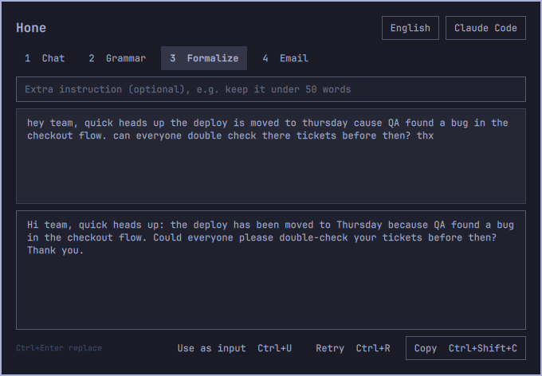
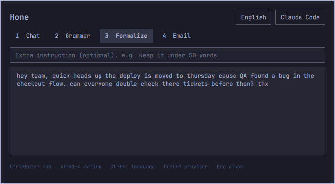

# Hone

An [Omarchy](https://omarchy.org) overlay that polishes text before you send it.
Select the text in any app (Slack, email, a PR, a terminal), press the hotkey,
press `Ctrl+Enter` twice, and Claude Code or Codex's rewrite replaces your
selection in place.



- **Replace in place**: the result is pasted over your selection, and stays on the clipboard as a fallback.
- **Actions**: Chat, Grammar, Formalize, Email out of the box, and your own in the config.
- **Extra instruction** for one-off tweaks ("keep it under 50 words").
- **Language**: keep the input's language, or force English, Spanish, or any language you add.
- **Claude Code or Codex**, using the CLI you are already signed in to. No API keys.
- Streams the answer as it is written; cancel, retry, or feed the result back in.
- Native to Omarchy: follows your theme and grabs the keyboard like the emoji picker.

## Requirements

- Omarchy with its Quickshell shell (Hyprland)
- [Claude Code](https://claude.com/claude-code) (`claude`) or [Codex](https://github.com/openai/codex) (`codex`),
  installed and signed in. Your text is sent to the provider you pick.
- `wl-clipboard` (`wl-copy`, `wl-paste`), included in Omarchy

No sudo, services, or downloads: Hone only runs the CLIs above, `wl-copy`/`wl-paste` and `hyprctl`.

## Install

```bash
omarchy plugin add https://github.com/GermanGomez182/hone --enable
```

Then bind a key in `~/.config/hypr/bindings.lua`:

```lua
o.bind("SUPER + CTRL + G", "Hone", { panel = "io.github.germangomez182.hone" })
```

Pressing the key again closes the panel.

## Update

```bash
omarchy plugin update io.github.germangomez182.hone
omarchy restart shell
```

The shell only picks up new plugin code after a restart.

## Remove

```bash
omarchy plugin remove io.github.germangomez182.hone
```

Then delete the `o.bind(...)` line from `~/.config/hypr/bindings.lua`. Hone's own
files are `~/.config/hone/` (settings) and `~/.local/state/hone/` (remembered
provider); delete them too if you do not plan to reinstall.

## Use



| Key | Does |
| --- | --- |
| `Ctrl+Enter` | Run the action; once there is a result, close and paste it over your selection |
| `Alt+1` ... `Alt+9` | Pick an action |
| `Ctrl+L` | Cycle the output language |
| `Ctrl+P` | Switch between Claude Code and Codex (remembered) |
| `Ctrl+Shift+C` | Copy the result |
| `Ctrl+R` | Retry |
| `Ctrl+U` | Use the result as the new input |
| `Esc` | Cancel a running request, otherwise close |

## Configure

Hone creates an empty `~/.config/hone/config.json` (`{}`) the first time it
loads. Add only the settings you want to change; everything you leave out uses
the defaults below, including improved defaults in later versions. The panel
picks up changes on save. Unknown keys and wrong types are reported in the panel
rather than ignored.

```json
{
  "language": "Spanish",
  "providers": { "claude": { "model": "sonnet" } }
}
```

| Setting | Default | Meaning |
| --- | --- | --- |
| `provider` | `"claude"` | `"claude"` or `"codex"`; the last one picked with `Ctrl+P` wins |
| `language` | `"auto"` | `"auto"` keeps the input's language, or one of `languages` |
| `languages` | `["English", "Spanish"]` | What `Ctrl+L` cycles through after auto |
| `prefill` | `"auto"` | Start with the selection (`"auto"` falls back to the clipboard), `"selection"`, `"clipboard"` or `"none"` |
| `pasteBack` | `true` | `Ctrl+Enter` pastes the result over your selection; `false` only copies it |
| `closeOnCopy` | `false` | Close after `Ctrl+Shift+C` (`Ctrl+Enter` always closes) |
| `timeoutSeconds` | `60` | Give up after this long (1 to 600) |
| `providers.claude` | `claude`, model `haiku` | `binary`, `model` (empty = the CLI's default), `extraArgs` |
| `providers.codex` | `codex`, low reasoning effort | Same fields |
| `systemPrompt` | see `Config.js` | Shared instructions sent with every action |
| `actions` | four actions | Up to nine `{ "id", "label", "prompt" }` entries, bound to `Alt+1..9` |

Example action:

```json
{ "id": "pr", "label": "PR comment", "prompt": "Rewrite as a short, kind code review comment." }
```

## How replacing works

Hone reads your selection through Wayland's primary selection, so there is no
need to copy first, and remembers which window you were in. On accept it puts
the result on the clipboard, closes, and once the panel is gone sends that window
the same paste Omarchy's `Super+V` does: `Ctrl+V` in apps, `Ctrl+Shift+V` in
terminals. If the app dropped its selection, the result lands at the cursor
instead, and it always stays on the clipboard so you can paste it by hand.

## Privacy

Your text goes to the provider you pick, through its CLI, exactly as if you had
pasted it into `claude` or `codex` yourself. Hone passes it on stdin (never as a
command-line argument), runs Claude Code with no tools, MCP servers, settings or
saved session, runs Codex read-only and ephemeral, and never logs the text.

## Report a problem

Open an [issue](https://github.com/GermanGomez182/hone/issues/new/choose) with the
keys you pressed and the output of:

```bash
qs log -p /usr/share/omarchy/shell | grep -i hone | tail -40
```

The log records states and errors only, never your text.

## Develop

```bash
bin/test                # unit tests (node) + omarchy plugin validate
bin/test --integration  # also drives the backend in a real Quickshell against fake CLIs
bin/screenshots         # regenerates the README images with invented text (hands off for ~20 s)
```

The logic lives in plain JavaScript files tested with `node --test`: `Config.js`
(settings), `Prompt.js`, `Providers.js` (CLI commands and stream parsing) and
`PanelState.js` (the panel's state machine). `HoneBackend.qml` runs the CLI and
`Hone.qml` draws the panel.

Strings live in `i18n/<language>.json`; English is complete and missing strings
fall back to it. Translations are welcome.

## License

MIT
